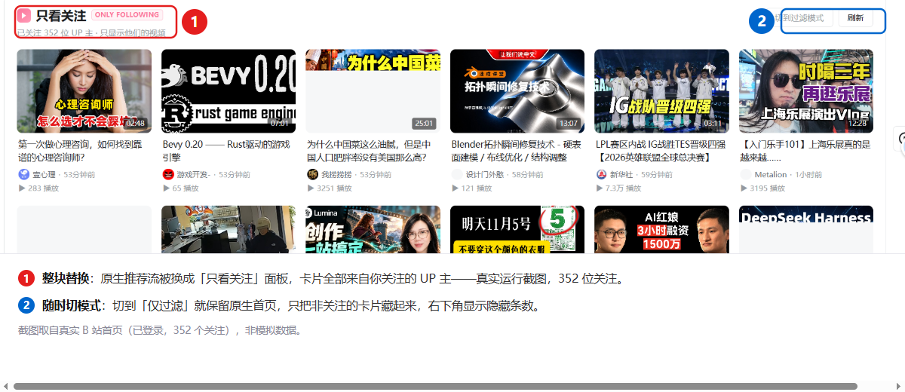
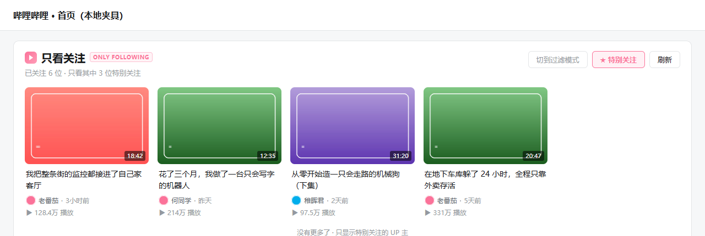
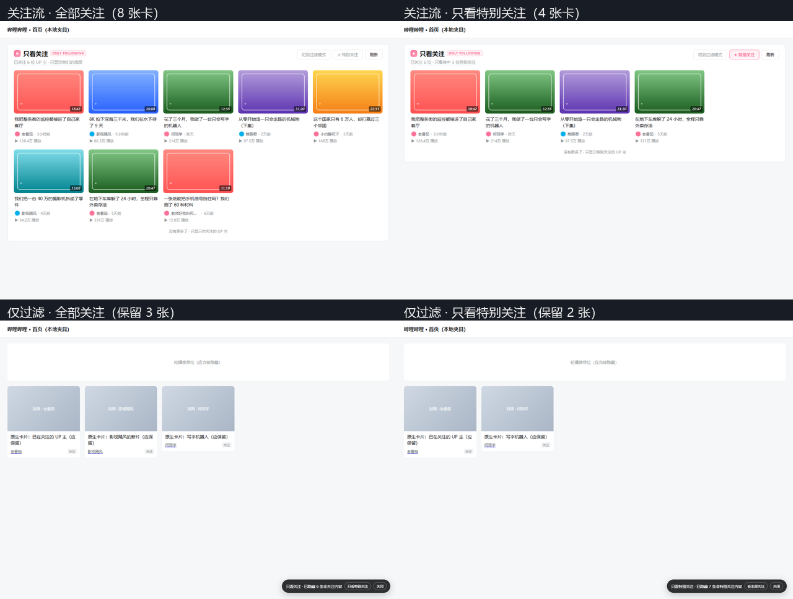
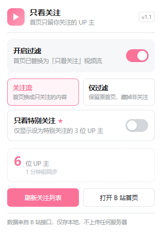
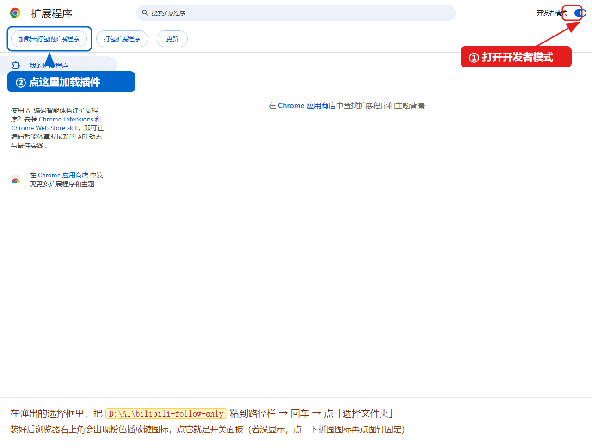
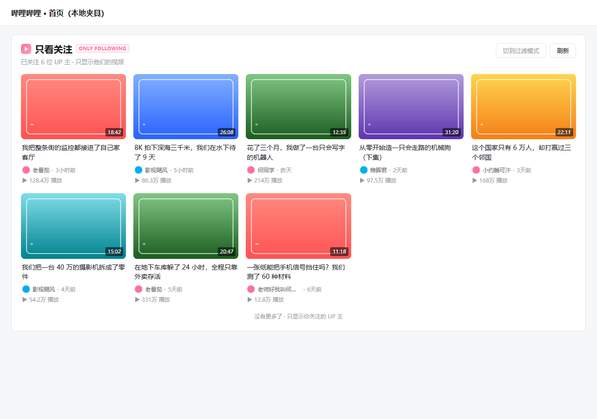

# B站 · 只看关注

> 打开 B 站首页，只看得到你关注的 UP 主；想更狠一点，可以只看「特别关注」。

一个 Chrome / Edge 扩展（Manifest V3）：把首页整块推荐流替换成一条「只来自关注 UP 主」的视频流，也可以切成温和一点的「仅过滤」模式，保留原生首页、只把非关注内容藏起来。两种模式都能一键收窄到「只看特别关注」。

零依赖、零上报、全部数据跑在你自己已登录的浏览器里。



<sub>真实运行截图：已登录状态、352 个关注，卡片全部来自关注的 UP 主。</sub>

---

## 为什么做这个

B 站首页的推荐流是会"驯化"人的：你多看两眼的东西，第二天铺满整个屏幕。而关注列表恰恰是你自己主动做的选择。

这个扩展只做一件事——**把首页还给你自己的选择**。

## 两种模式

| 模式 | 行为 | 适合 |
|---|---|---|
| **关注流**（默认） | 隐藏原生推荐流，在首页顶部注入「只看关注」面板，卡片来自关注 UP 主的视频动态 | 想彻底清空推荐、只刷关注的人 |
| **仅过滤** | 保留 B 站原生首页，只把「UP 主不在你关注列表里」的卡片隐藏，右下角显示隐藏数量 | 只想筛掉推荐、还想看原生布局的人 |

弹窗里随时切换，切换后当前页面立刻重载生效，不用手动刷新。

---

## 只看特别关注（v1.1）

默认范围是「全部关注」。打开「只看特别关注」后，两种模式都会把范围收窄到你标了 ★ 的 UP 主：

| 位置 | 控件 |
|---|---|
| 工具栏弹窗 | 「只看特别关注」开关，副标题直接显示已设的位数 |
| 首页注入面板 | 右上角 `☆ / ★ 特别关注` 按钮，激活时粉色高亮 |
| 仅过滤模式 | 右下角胶囊上的「只看特别关注 / 看全部关注」按钮 |

三处改的是同一个配置，任一处切换后其余两处和已打开的 B 站首页会立刻同步。



<sub>开启后副标题变成「只看其中 N 位特别关注」，卡片只剩这几位的视频。</sub>



<sub>四种组合对照：上排关注流（8 → 4 张卡），下排仅过滤（保留 3 → 2 张），右下角胶囊显示当前范围与隐藏数量。</sub>

**数据怎么来的**：`x/relation/followings` 返回的每个关注对象自带 `special` 标记（`1` = 特别关注）或 `tag` 数组里的 `-10`（特别关注分组 ID），所以**不需要额外请求**。如果哪天 B 站不再返回这个字段，扩展会自动走 `/x/relation/tags` + `/x/relation/tag?tagid=-10` 兜底，并把结果和关注列表一起缓存 12 小时。

**降级**：如果一个特别关注都读不到（没设置过、接口被风控、隐私设置），不会把首页搞白 —— 自动按「全部关注」显示，并在面板/胶囊上明确提示。

关注流模式下特别关注的视频往往比较稀疏，开启后会自动往下多翻几页（最多 6 页）凑够卡片，而不是只显示第一屏。

---

弹窗里还有：

- 总开关（关掉 = 完全不管，首页恢复原样）
- **只看特别关注**（上面这节）
- 关注数量 + 上次同步时间
- 「刷新关注列表」（清缓存重拉，同时刷新特别关注标记）
- 「打开 B 站首页」



<sub>工具栏弹窗：总开关、模式切换、特别关注开关、关注数与同步时间。</sub>

---

## 安装

### Chrome / Edge（手动加载，3 步）

1. 把仓库克隆到本地任意目录
   ```bash
   git clone https://github.com/jokerlee0524-cloud/bilibili-follow-only.git
   ```
2. 地址栏打开 `chrome://extensions`（Edge 是 `edge://extensions`）
3. 右上角打开「开发者模式」→ 左上角点「加载未打包的扩展程序」→ 选中克隆下来的文件夹

> 注意 Chrome 较新版本把「加载已解压的扩展程序」改叫了「**加载未打包的扩展程序**」，位置没变，都在扩展页左上角。开发者模式那个开关藏在最右上角，很小，容易找不到。



<sub>① 右上角打开开发者模式 → ② 左上角点「加载未打包的扩展程序」，选中本仓库文件夹。</sub>

### 其他 Chromium 内核浏览器

部分 Chromium 分支（如豆包浏览器）仍支持命令行加载，启动时带上扩展目录即可：

```bash
<浏览器可执行文件> --load-extension=/path/to/bilibili-follow-only https://www.bilibili.com/
```

> 命令行参数只在**启动时**生效，所以要先完全退出浏览器再带参数启动。
> Chrome 138+ 已经禁用这个开关，只能走上面的手动加载。

装好后打开 <https://www.bilibili.com/>，首页顶部出现「只看关注」面板即成功。建议把图标固定到工具栏，点开就能一键开关。

---

## 它是怎么做到"只有关注"的

全部数据都来自 B 站自己的接口，跑在你已登录的浏览器里：

1. `GET /x/web-interface/nav` —— 拿登录态和 wbi 签名密钥
2. `GET /x/relation/followings?vmid=...` —— 分页拉全关注列表，顺带读出每人的 `special` / `tag[-10]` 特别关注标记（500 个关注就是 10 页）
3. `GET /x/polymer/web-dynamic/v1/feed/all?type=video` —— 关注 UP 的**视频动态**，天然只包含关注的人
4. 兜底：`GET /x/relation/tags` → `GET /x/relation/tag?tagid=-10` —— 只在特别关注标记读不到时才调用

其中动态接口需要 wbi 签名（`w_rid` + `wts`），扩展里自带了一份 MD5 和签名实现（`md5.js` / `wbi.js`），**不依赖任何第三方库**。

原生首页那边则按卡片上的 `a[href*="space.bilibili.com/"]` 抠出 UP 主 mid，比对**当前生效的 UP 主集合**（全部关注 / 特别关注），决定保留还是隐藏。关注流模式同理，在已拉到的视频动态上按作者 mid 过滤。

---

## 权限与隐私

- `storage`：只存「开关 / 模式 / 范围」和关注列表缓存（含特别关注标记），**全部在本机**
- `host_permissions`：`api.bilibili.com`、`www.bilibili.com`，只用于读写上面几个接口
- 没有任何上报、没有第三方服务器、不碰账号密码

关注列表缓存 12 小时，过期后下次打开首页自动重拉；弹窗里的「刷新关注列表」可以立即重拉。

---

## 已知限制（诚实版）

- **必须登录 B 站**。未登录时接口只返回 `-101`，面板会提示「去登录」。
- 关注流走的是「视频动态」，所以：只投专栏 / 动态不投视频的 UP 不会出现；刚发但还没生成动态的可能延迟几分钟。
- B 站改版是常态。代码对新版首页（`#app > main.bili-feed4-layout > .feed2`）和旧版首页（`#i_cecream`）都做了兼容；如果哪天关注流接口挂了，扩展会**自动降级到「仅过滤」模式**并在面板里提示，而不是把首页搞白。
- 「仅过滤」模式依赖卡片 DOM 里的 `space.bilibili.com/<mid>` 链接；广告卡、活动卡这类认不出作者的会被一并隐藏（这是有意的）。
- 「只看特别关注」依赖 B 站关系列表里的 `special` / `tag[-10]` 标记；标记缺失时会走分组接口兜底，两者都失败则自动按全部关注显示并提示，不会白屏。
- 特别关注范围下首页只显示这几位的**视频动态**，若他们近期没投稿，面板可能为空（会自动多翻几页）。
- 扩展 ID 通过 `manifest.json` 里的 `key` 字段固定，换目录安装也不会丢配置。

---

## 目录结构

```
bilibili-follow-only/
├─ manifest.json      MV3 清单
├─ CHANGELOG.md       更新日志
├─ feed.js            内容脚本：注入面板 / 过滤卡片 / 降级逻辑
├─ feed.css           面板与卡片样式（含隐藏原推荐的规则、深色模式）
├─ wbi.js             接口封装：nav、关注列表、特别关注分组、关注动态流、wbi 签名
├─ md5.js             纯 JS MD5（wbi 签名用）
├─ bg.js              Service Worker：首次安装写默认配置
├─ popup.html/js/css  工具栏弹窗
├─ icons/             16/32/48/128 图标
├─ docs/              截图（真实运行、安装指引、特别关注、新版弹窗）
└─ test/              本地夹具
   ├─ fixture.html    模拟 B 站首页 DOM，9 张卡（3 关注 / 6 非关注）
   └─ mock/           nav / followings / special / dynamic 四个接口的假数据
                      （6 位关注，其中 3 位设为特别关注）
```

## 本地调试

```bash
# 起夹具服务
cd test && python -m http.server 8130 --bind 127.0.0.1

# 用测试版 manifest（多一条 127.0.0.1 的匹配规则）加载扩展
# 夹具地址：
#   ?dev=1&mode=replace&special=0      关注流 · 全部关注（8 张卡）
#   ?dev=1&mode=replace&special=1      关注流 · 只看特别关注（4 张卡）
#   ?dev=1&mode=filter&special=0       仅过滤 · 全部关注（留 3 张）
#   ?dev=1&mode=filter&special=1       仅过滤 · 只看特别关注（留 2 张）
#   ?dev=1&special=1&nospecial=1       模拟读不到特别关注（自动降级）
#   ?dev=1&special=1&nofield=1         模拟 B 站不返回 special 字段（走分组接口兜底）
#   ?dev=1&off=1                       关闭态
```

夹具里建议把 `mode` / `special` 都写全：`?dev=1` 只在参数显式给出时覆盖 storage，写全才能保证多次运行结果可重复。

`?dev=1` 只对 `127.0.0.1 / localhost` 生效，真实站点上不存在这个分支；本地夹具需要临时给 `manifest.json` 的 `matches` 加一条 `http://127.0.0.1:8130/*`（正式包里没有）。
夹具里的封面图（`test/mock/covers/`）不随仓库分发，本地调试时随便放几张图即可。

夹具环境下长这样（封面是渐变占位图，用来验证布局和过滤逻辑）：



---

## License

[MIT](LICENSE)
